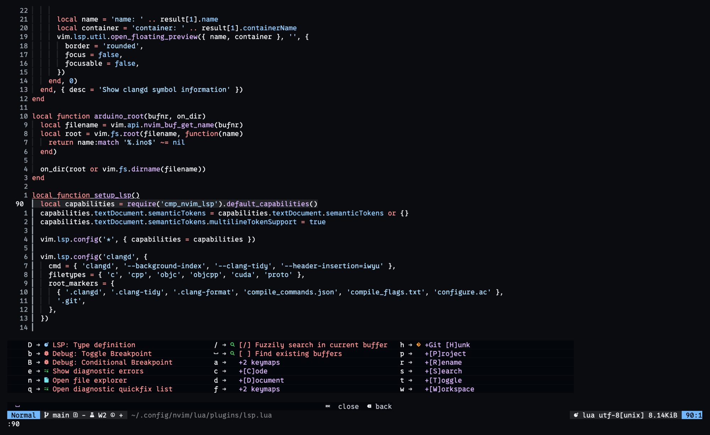
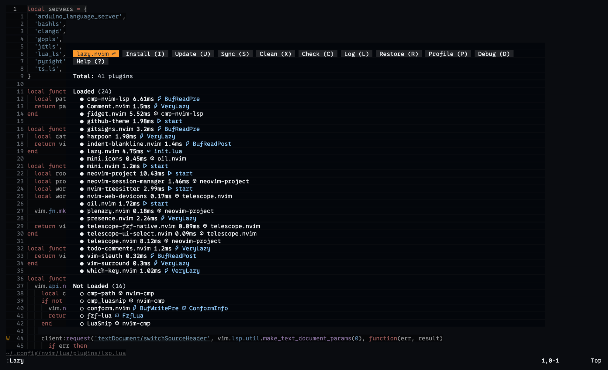

<p align="center">
  
</p>

<h1 align="center">brian-nunez.nvim</h1>

<p align="center">
  <b>Neovim configuration; a lazy-loaded, cross-platform setup built on the native LSP API, with no Mason.</b>
</p>

<p align="center">
  A production Neovim setup for Go, Java, Python, TypeScript, C/C++, Lua, Bash and Arduino, using system-installed tools on macOS and Linux.<br>
  <i>By Brian Nunez.</i>
</p>

<p align="center">
  
  
  
  
  <br>
  <a href="https://github.com/brian-nunez/brian-nunez.nvim/releases"></a>
</p>

<p align="center">
  <a href="docs/installation.md"></a>
</p>

<p align="center">
  <a href="docs/installation.md"><b>Installation</b></a> ·
  <a href="docs/plugins.md">Plugins and key mappings</a> ·
  <a href="https://github.com/brian-nunez/brian-nunez.nvim/releases">Releases</a>
</p>

<br>

<p align="center">
  
  <br><sub><b>Leader mappings</b>: which-key lists every mapping and group the moment Space is pressed.</sub>
</p>

> [!IMPORTANT]
> **Language servers and formatters are not installed for you.** This configuration uses tools already on your `PATH`, and Mason is intentionally absent. Run `./check-dependencies.sh` to see what is missing and get the install command for each item.

<p align="center">
  <a href="#why-brian-nuneznvim">Why brian-nunez.nvim</a> ·
  <a href="#whats-included">What's included</a> ·
  <a href="#supported-languages">Supported languages</a> ·
  <a href="#quick-start">Quick start</a> ·
  <a href="#project-skills">Project skills</a> ·
  <a href="#documentation">Documentation</a> ·
  <a href="#license">License</a>
</p>

## Why brian-nunez.nvim

- **Native.** Language servers are configured with `vim.lsp.config()` and enabled with `vim.lsp.enable()`, without a server-management plugin.
- **System tooling.** Language servers and formatters come from your package managers, so the editor and your shell resolve the same binaries.
- **Reproducible.** `lazy-lock.json` pins all 41 plugins to exact commits and stays committed.
- **Lazy-loaded.** `lazy.nvim` manages plugins and defers many of them to events, commands, file types, or key presses.
- **Verifiable.** The read-only `check-dependencies.sh` and `:checkhealth config` report missing tools. The checker prints an install command for each one and changes nothing.
- **Cross-platform.** One configuration supports macOS on Apple Silicon, Ubuntu Desktop 24.04 on AMD64, and Omarchy on x86_64.

## What's included

Each group below is a summary. The full inventory, with loading behavior and every key mapping, is in [docs/plugins.md](docs/plugins.md).

### Editing and interface

| Feature | Description |
| ------- | ----------- |
| **Commenting** | `Comment.nvim` toggles comments with `gc` motions, and `todo-comments.nvim` highlights TODO and FIXME keywords. |
| **Text Objects and Surroundings** | `mini.ai`, `mini.surround`, and `vim-surround` extend selections and edit paired delimiters. |
| **Indentation** | `vim-sleuth` detects indent settings, and `indent-blankline.nvim` draws guides. |
| **Key Discovery** | `which-key.nvim` shows available key sequences with no delay. |
| **Theme and Status Line** | The GitHub dark high-contrast colorscheme with `mini.statusline`. |
| **Focus Mode** | `zen-mode.nvim` provides distraction-free editing through `:ZenMode`. |

### Files, search, and projects

| Feature | Description |
| ------- | ----------- |
| **File Browsing** | `oil.nvim` edits the filesystem like a buffer, in a window or a float. |
| **Fuzzy Search** | Telescope searches files, text, help, diagnostics, buffers, and LSP symbols, with `fzf-lua` available as `:FzfLua`. |
| **Marked Files** | `harpoon` adds fast jumps between marked files, with direct mappings for the first four. |
| **Projects and Sessions** | `neovim-project` discovers projects and restores their sessions. |

### LSP, completion, and formatting

| Feature | Description |
| ------- | ----------- |
| **Language Servers** | Eight servers on the native LSP API, with `fidget.nvim` progress notifications. |
| **Completion** | `nvim-cmp` with LSP, snippet, and path sources, plus LuaSnip for snippets. |
| **Format on Save** | `conform.nvim` runs StyLua and `templ`, then falls back to LSP formatting. |
| **Syntax** | `nvim-treesitter` provides parser-based highlighting and indentation. |

### Debugging, Git, and embedded work

| Feature | Description |
| ------- | ----------- |
| **Go Debugging** | `nvim-dap` and `nvim-dap-ui` debug Go programs and tests through Delve. |
| **Git** | Fugitive runs Git commands, Rhubarb adds `:GBrowse`, and `gitsigns.nvim` marks changed lines. |
| **Arduino** | Compile with `<leader>ac` and upload with `<leader>au`, targeting the Uno R4 WiFi. |
| **TinyGo** | `tinygo.nvim` adds embedded Go commands when TinyGo is installed. |
| **LaTeX** | VimTeX handles compilation and PDF preview when LaTeX tools are installed. |

<p align="center">
  
  <br><sub><b>Plugin dashboard</b>: <code>:Lazy</code> shows each plugin's load time and what triggered it.</sub>
</p>

## Supported languages

| Language | Language server | Formatter | Debugger |
| -------- | --------------- | --------- | -------- |
| Arduino | `arduino_language_server` | LSP fallback | |
| Bash | `bashls` | LSP fallback | |
| C and C++ | `clangd` | LSP fallback | |
| **Go** | `gopls` | LSP fallback | Delve |
| Java | `jdtls` | LSP fallback | |
| JavaScript and TypeScript | `ts_ls` | LSP fallback | |
| Lua | `lua_ls` | StyLua | |
| Python | `pyright` | LSP fallback | |
| Templ | | `templ` (optional) | |

## Quick start

```bash
git clone https://github.com/brian-nunez/brian-nunez.nvim.git ~/.config/nvim   # clone the configuration
cd ~/.config/nvim                                                              # enter the directory
./check-dependencies.sh                                                        # report missing tools
nvim                                                                           # install plugins and start
```

Neovim 0.11.5 or newer is required. Platform-specific install commands are in [docs/installation.md](docs/installation.md).

After the first start:

- Run `:Lazy` to inspect plugin status.
- Run `:checkhealth config` to verify Neovim and external executables.
- Run `:checkhealth vim.lsp` inside a project to inspect LSP clients.

The leader key is `Space`.

## Layout

```text
.
├── init.lua
├── check-dependencies.sh
├── lazy-lock.json
├── docs/
│   ├── brand/
│   ├── images/
│   ├── installation.md
│   └── plugins.md
├── skills/
│   ├── nvim-add-language/
│   │   └── SKILL.md
│   └── nvim-add-plugin/
│       └── SKILL.md
└── lua/
    ├── config/
    │   ├── autocmds.lua
    │   ├── health.lua
    │   ├── keymaps.lua
    │   └── options.lua
    └── plugins/
        └── *.lua
```

## Maintenance

- Add plugin specs under `lua/plugins/`.
- Keep external tools on `PATH` before starting Neovim.
- Update plugins through `:Lazy`.
- Update Tree-sitter parsers through `:TSUpdate`.
- Keep `lazy-lock.json` committed to preserve reproducible plugin versions.

## Project skills

- Use [`nvim-add-language`](skills/nvim-add-language/SKILL.md) when adding an LSP, formatter, debugger, runtime, or other language support.
- Use [`nvim-add-plugin`](skills/nvim-add-plugin/SKILL.md) when adding or updating a Neovim plugin.

Both skills preserve the native Neovim 0.11 architecture, cross-platform dependency checks, health checks, documentation, and lazy-loading conventions used by this repository.

## Documentation

- [Installation and external software](docs/installation.md)
- [Plugin inventory and key mappings](docs/plugins.md)

## License

brian-nunez.nvim is licensed under the [MIT License](LICENSE.md).
